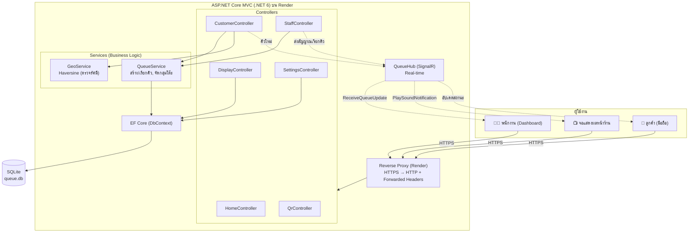
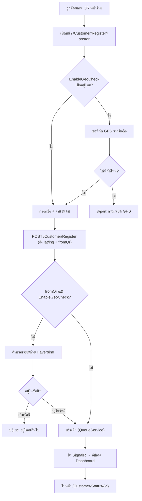
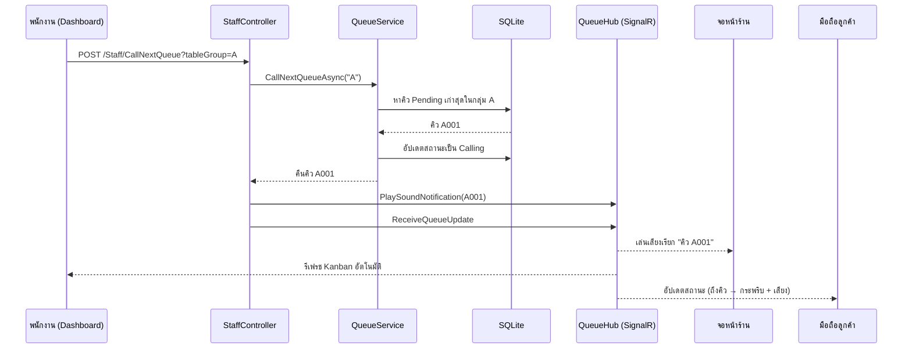
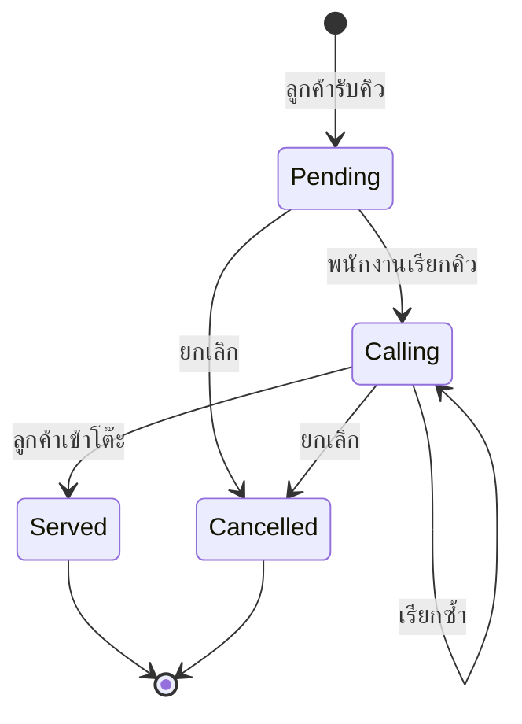
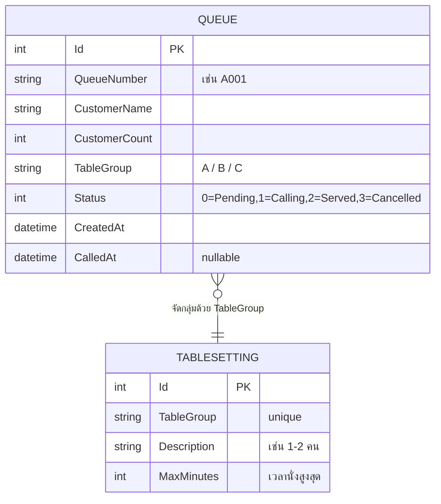

# System Design — ระบบจองคิวออนไลน์ (Que_Reservation)

ไดอะแกรมทั้งหมดเขียนด้วย Mermaid นำโค้ดในแต่ละบล็อกไปวางที่ https://mermaid.live ได้ทันที

---

## 1) High-Level Architecture (ภาพรวมระบบ)



---

## 2) Flow การจองคิวผ่าน QR (ตรวจ GPS)



---

## 3) Flow การเรียกคิว (พนักงาน → Real-time)



---

## 4) สถานะของคิว (State Diagram)



---

## 5) โครงสร้างข้อมูล (ER Diagram)


```
